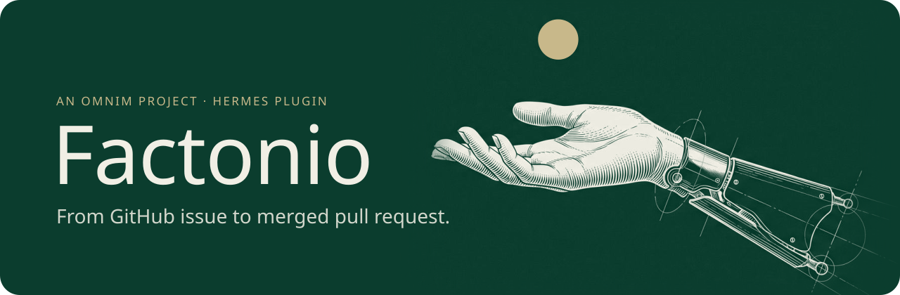
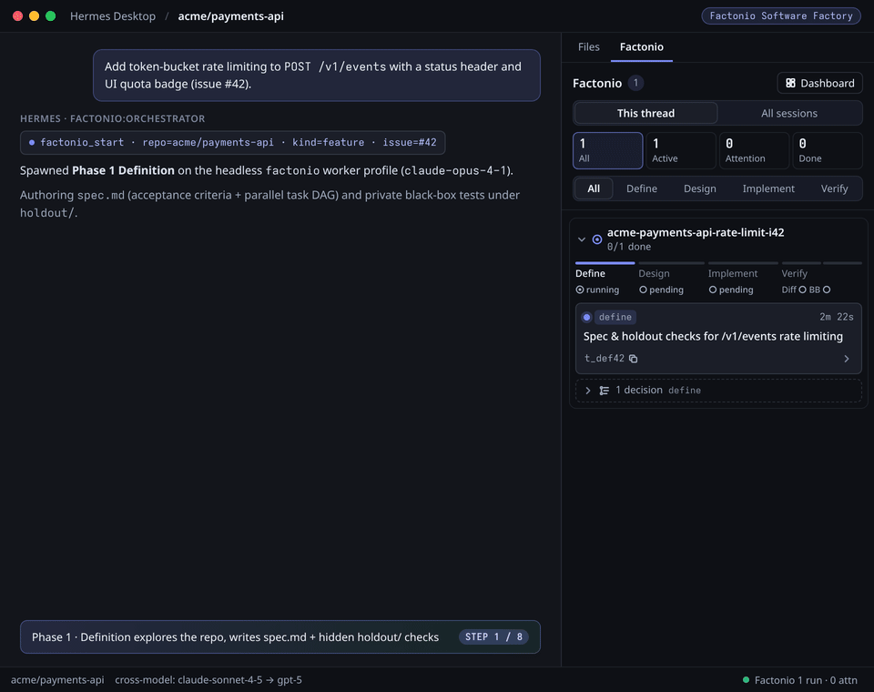
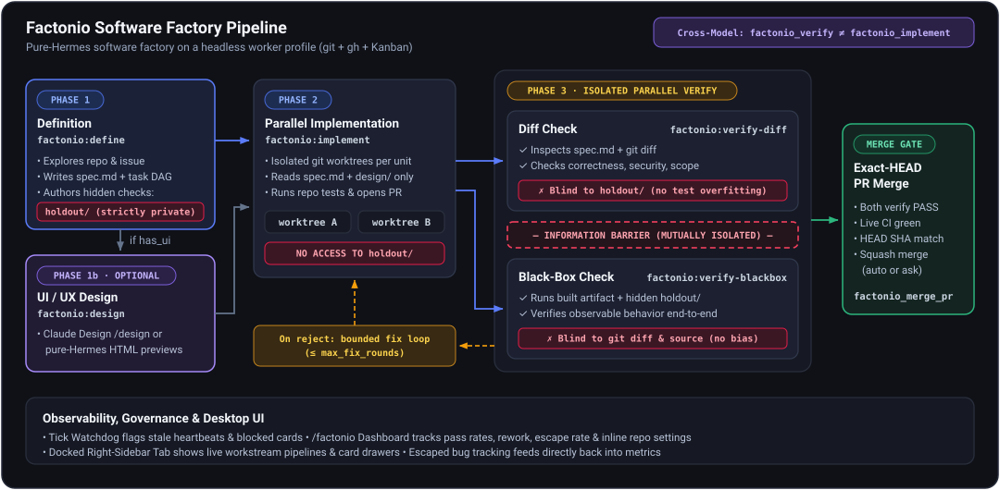
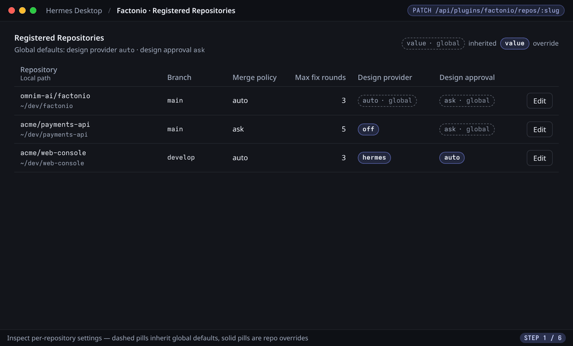
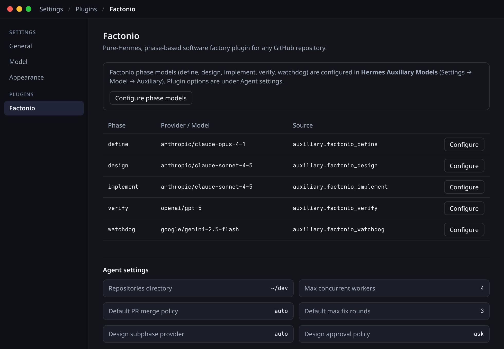

<p align="center">
  <picture>
    <source media="(prefers-color-scheme: dark)" srcset="docs/images/banner.svg">
    <source media="(prefers-color-scheme: light)" srcset="docs/images/banner-light.svg">
    
  </picture>
</p>

<p align="center">
  <b>Pure-Hermes, phase-based software factory plugin for any GitHub repository.</b><br>
  Definition, optional UI Design, parallel git-worktree Implementation, and mutually isolated Diff + Black-Box Verification — using only <a href="https://github.com/NousResearch/hermes-agent">Hermes Agent</a>, <code>git</code>, and <code>gh</code>.
</p>

<p align="center">
  <a href="https://github.com/omnim-ai/factonio/actions/workflows/ci.yml"></a>
  <a href="https://github.com/omnim-ai/factonio/actions/workflows/hermes-upstream.yml"></a>
  <a href="LICENSE"></a>
</p>

<p align="center">
  <a href="#quick-start"><b>Quick Start</b></a> ·
  <a href="#how-it-works"><b>How It Works</b></a> ·
  <a href="#desktop-ui"><b>Desktop UI</b></a> ·
  <a href="#developing-and-contributing"><b>Develop &amp; Contribute</b></a> ·
  <a href="docs/architecture.md">Architecture</a>
</p>

<p align="center">
  
  <br><sub>End-to-end Factonio workstream in Hermes Desktop: Define → Design → Implement → isolated Diff + Black-Box Verification → bounded fix round → exact-HEAD merge.</sub>
</p>

## Choose your starting point

| Run Factonio on your repos | Tune cross-model verification | Develop or contribute |
|---|---|---|
| [Quick Start](#quick-start) | [Configure phase models](#3-configure-phase-models) | [Development guide](docs/development.md) |
| Install the plugin, initialize the headless `factonio` worker profile, and register a GitHub repo. | Assign distinct models to `factonio_implement` and `factonio_verify` in Hermes Auxiliary Models. | Run all 90 clean-room tests locally, inspect the Desktop UI harness, and read [CONTRIBUTING.md](CONTRIBUTING.md). |

## How it works

Factonio runs autonomous software delivery on a dedicated headless `factonio` worker profile across four explicit phases, with a strict **Information Barrier** during verification to prevent confirmation bias and test overfitting:



1. **Phase 1 — Definition (`factonio:define`)** explores the repository, writes `spec.md` (acceptance criteria, technical plan, and a parallel task DAG), and authors hidden black-box acceptance checks under `holdout/`.
2. **Phase 1b — Optional UI/UX Design (`factonio:design`)** runs when a task touches UI (`has_ui: true` or on request). It supervises interactive Claude Design (`/design`) when the `claude` CLI is authenticated, or falls back automatically to pure-Hermes HTML/CSS previews.
3. **Phase 2 — Parallel Implementation (`factonio:implement`)** dispatches independent spec units in parallel git worktrees (reading `spec.md` and approved `design/` only — never `holdout/`), runs repository tests, and opens GitHub pull requests.
4. **Phase 3 — Isolated Parallel Verification (`factonio:verify-diff` + `factonio:verify-blackbox`)** launches two concurrent, mutually isolated checks on every PR:
   - **Diff Check** inspects `spec.md` and `git diff` without ever seeing `holdout/`.
   - **Black-Box Check** runs the built artifact against acceptance criteria and `holdout/` without reading source code or diffs.
   - On rejection, Factonio runs bounded repair rounds (up to `max_fix_rounds`, reporting only observable symptoms). Once GitHub CI and both checks pass on the **exact live `head_sha`**, the PR squash-merges automatically (or waits for approval when `merge_policy: ask`).
   - **Local-first publishing (`publish_policy: ask`):** with the default `publish_policy: auto` (global `default_publish_policy`), Implementation pushes its branch and opens the PR itself. With `publish_policy: ask`, Implementation commits only on a local worktree branch (no `git push`, no `gh pr create`), both checks (and `rigor="high"` panels) verify the unpublished branch at its exact `head_sha`, and nothing reaches GitHub until you approve. The orchestrator then publishes that exact verified SHA with `factonio_publish_pr` (`hermes factonio publish-pr`), and the normal GitHub CI, PR gate, and `merge_policy` flow takes over.

For a full technical breakdown of worktrees, storage locking, watchdog ticks, and API endpoints, see [docs/architecture.md](docs/architecture.md).

## Desktop UI

Factonio ships a zero-build Hermes Desktop UI (`desktop/plugin.js`) using only public `@hermes/plugin-sdk` surfaces and live host theme tokens.

### Metrics Dashboard (`/factonio`)

Track workstream throughput, Diff vs Black-Box pass rates, rework rate, post-merge escape rate, high-rigor verification panel outcomes (with disagreements highlighted), a Trends strip of long-term `trail.db` snapshots (inline-SVG sparklines for pass rate, escape rate and throughput), per-phase median/P90 durations, the append-only Decision History (Key Decisions / Attention / All presets, search, an audit Attention banner, folded routine gate ticks, inline supersession chains, an Evidence Inspector and confirmation-gated human decisions), phase model assignments with the configured verify panel's readiness and vendor diversity, and registered repositories in one place:


### Inline Repository Settings Editor

Edit any registered repository's `default_branch`, `merge_policy`, `publish_policy`, `max_fix_rounds`, `design_provider`, `design_approval`, or `default_rigor` directly in `/factonio` — clearly distinguishing inherited global defaults (`value · global`) from per-repo overrides:



### Docked Right-Sidebar Tab & Settings

Monitor active workstreams beside your chat transcript in the hideable **Factonio** tab docked next to **Files** — with live 4-stage pipeline bars, scope/status/phase filters, attention callouts, PR shortcuts, workstream mode badges (`refactor`, `perf`, `investigate · read-only`), opt-in `/arena` strips (candidate and judge vendors), high-rigor verification panel strips (consensus, vendor lanes and a disagreement callout), and expandable card detail drawers:

| Docked Factonio Sidebar Tab | Settings → Plugins → Factonio |
|:---:|:---:|
|  |  |

## Quick start

### Prerequisites

- [Hermes Agent](https://github.com/NousResearch/hermes-agent) installed and configured
- `git` and GitHub CLI (`gh`), authenticated via `gh auth login`
- Optional: `claude` CLI (authenticated) if you want Phase 1b to use interactive Claude Design (`/design`); otherwise Factonio falls back cleanly to pure-Hermes prototyping

### 1. Install and enable the plugin

```bash
hermes plugins install git@github.com:omnim-ai/factonio.git
hermes plugins enable factonio
```

> If using Hermes Desktop, toggle **Factonio** on once under **Capabilities → Plugins** to enable the Desktop dashboard, docked sidebar tab, Settings page, and status bar pill.

### 2. Initialize the headless worker profile

```bash
hermes factonio init --apply-config
hermes factonio doctor
```

`hermes factonio init` creates the dedicated headless `factonio` profile (`approvals.mode: off`), links the Factonio plugin into it so workers resolve every `factonio:*` skill, and applies the recommended root Kanban settings (`kanban.dispatch_in_gateway: true`, `kanban.auto_decompose: false`).

### 3. Configure phase models

Factonio registers five native Hermes Auxiliary Model slots:

| Slot | Phase | Recommendation |
|---|---|---|
| `factonio_define` | Definition | Strong reasoning/planning model |
| `factonio_design` | Phase 1b Design (optional) | UI/frontend-capable model |
| `factonio_implement` | Implementation | Fast, accurate coding model |
| `factonio_verify` | Diff + Black-Box Verification | **Different vendor family from Implementation** for cross-model independence (e.g. Claude vs GPT or Gemini) |
| `factonio_watchdog` | Ambiguous stall triage (optional) | Low-cost fast model |

> **Single-provider multi-vendor routers work out of the box:** If you use **Nous Portal (`nous`)**, **OpenRouter (`openrouter`)**, **Vertex (`vertex`)**, **Bedrock (`bedrock`)**, or another multi-vendor router, you do **not** need a second chat provider for cross-vendor verification or `rigor="high"` panels — simply pick models from different vendor families on that same provider (for example `nous` with `anthropic/claude-...` for `factonio_implement` and `nous` with `openai/gpt-...` or `google/gemini-...` for `factonio_verify`).

Set them in `hermes model` → **Auxiliary Models** or Hermes Desktop **Settings → Model → Auxiliary**, then verify the resolved matrix:

```bash
hermes factonio models
```

### 4. Register a repository and start work

```bash
hermes factonio add owner/repo
```

Then ask your Hermes chat session to build a feature or fix an issue on `owner/repo` — Factonio's orchestrator coordinates Definition, optional Design, parallel Implementation, isolated Verification, and the PR merge gate automatically.

### Edit repository settings anytime

Adjust any registered repository's settings without re-adding it (only passed flags change):

```bash
hermes factonio update owner/repo --merge-policy ask --max-fix-rounds 5
hermes factonio update owner/repo --publish-policy ask   # verify locally, publish PRs only on approval
hermes factonio update owner-repo --default-branch develop
hermes factonio update owner/repo --design-provider hermes --design-approval auto
hermes factonio update owner/repo --design-provider inherit   # revert to global default
hermes factonio edit owner/repo --merge-policy auto --json    # `edit` is an alias
```

You can also edit settings from chat via `factonio_update_repo`, or inline on `/factonio` (`PATCH /api/plugins/factonio/repos/<slug>`).

## CLI and agent tools reference

<details>
<summary>CLI subcommands (<code>hermes factonio ...</code>)</summary>

| Command | Purpose |
|---|---|
| `hermes factonio init [--apply-config] [--workers N] [--force] [--force-link]` | Create or update the headless `factonio` worker profile and plugin link (refuses to link a persistent profile to an ephemeral worktree/workspace/scratch checkout unless `--force-link`) |
| `hermes factonio doctor [--json]` | Check `git`, `gh auth`, worker profile, Kanban config, and cross-model setup |
| `hermes factonio add <owner/repo> [--path DIR] [--merge-policy auto\|ask] [--publish-policy auto\|ask] [--max-fix-rounds N]` | Register, clone (unless `--no-clone`), anchor Hermes Project, and inspect CI |
| `hermes factonio update\|edit <repo> [--merge-policy ...] [--publish-policy auto\|ask] [--max-fix-rounds N] [--default-branch B] [--design-provider ...] [--design-approval ...] [--default-rigor standard\|high\|inherit]` | Update per-repo settings (`inherit` clears design and rigor overrides) |
| `hermes factonio list [--json]` | List registered repositories and active settings |
| `hermes factonio remove <repo>` | Unregister a repository (keeps local files intact) |
| `hermes factonio models [--repo SLUG] [--json]` | Show resolved provider/model per phase, default rigor, the high-rigor verify panel, and cross-model warning |
| `hermes factonio start <repo> <request> [--kind feature\|bug\|quick\|refactor\|perf\|investigate] [--title T] [--issue N] [--skip-define] [--escaped-from CARD] [--json]` | Start a workstream; `refactor` pins behavior, `perf` embeds the 7+7 benchmark checklist, `investigate` is read-only (writes `investigation.md`, no PRs, rejects `--skip-define`) |
| `hermes factonio status [--tenant T] [--json]` | Show active Factonio Kanban workstreams and cards |
| `hermes factonio panel [panel_id] [--tenant T] [--pr N] [--record] [--json]` | Evaluate a `rigor=high` verification panel's fail-closed consensus (`pass` / `reject` / `inconclusive` / `pending`), disagreement summary, and findings; `--record` logs a terminal consensus to `trail.db` (exits non-zero when no panel matches) |
| `hermes factonio arena spawn\|status [repo] [--request R] [--target define\|design] [--tenant T] [--candidate M ...] [--judge-model M] [--no-judge] [--strict-cross-vendor] [--arena-id ID] [--spawn-judge] [--json]` | Opt-in arena: fan out competing cross-vendor Definition or Design candidates (fails closed unless >= 2 vendor families) plus a dependent judge that hand-grafts the canonical artifact, or report read-only arena progress |
| `hermes factonio pr-gate <repo> <pr_number> [--json]` | Inspect live PR HEAD SHA, mergeability, and CI check status |
| `hermes factonio publish-pr <repo> <branch> --expected-head-sha <sha> --title <title> [--body <text> \| --body-file <path>] [--base B] [--draft] [--remote R] [--tenant T] [--card-id ID] [--json]` | Publish a locally verified branch (`publish_policy: ask`): refuses on any HEAD drift before any remote call, pushes exactly `<sha>:refs/heads/<branch>`, opens the PR via a temporary body file, and confirms it by live readback (exit `0` only when published) |
| `hermes factonio harness init\|check\|show\|audit <repo> [--force] [--dry-run] [--prove] [--base REF] [--run-doctor] [--run-hooks] [--json]` | Bootstrap, validate, show, or read-only drift-audit the repo's `.factonio/verify.md` + `harness.json` black-box verification harness (`init --prove` fails closed and rolls back unless Doctor, required hooks and evidence survival pass; `check` fails when required gates were removed/downgraded vs `--base`, default `HEAD`; `audit` exits non-zero when `stale` or `missing` and classifies drift as `doc_drift` / `harness_gap` / `product_regression`) |
| `hermes factonio restack <repo> [pr_number] [--parent-pr N] [--from-branch B] [--new-base B] [--old-base-sha SHA] [--verified-sha SHA] [--no-push] [--no-retarget] [--dry-run] [--json]` | Rebase a stacked PR (or every open child of a parent) onto its new base in a throwaway worktree and report `git patch-id` verdict continuity |
| `hermes factonio eval ab\|audit\|bloat <inputs...> [--phase P] [--seed S] [--model-a/-b M] [--provider-a/-b P] [--judge-model M] [--judge-provider P] [--strict-vendor] [--record-trail] [--dry-run] [--baseline PATH] [--strict] [--json]` | Offline, deterministic blind skill/model eval: `ab` blinds two candidate transcripts into seeded `Candidate X` / `Candidate Y` packets and unblinds the winner (barrier leaks disqualify; `--strict-vendor` fails closed on any unknown candidate/judge vendor or a shared judge vendor; `--dry-run` never writes `trail.db`); `audit` flags real Information Barrier leaks (exit 1); `bloat` measures skill token budgets (soft 3000 / hard 4500) for files or whole skill directories and reports `over_budget` skills with exit 0, or exit 1 with `--strict` / `--fail-on-over-budget`. Also runs without Hermes as `python3 tools/eval_skills.py ...` |
| `hermes factonio trail [--tenant T] [--repo R] [--phase P] [--card ID] [--limit N] [--markdown] [--json]` | Show the append-only decision trail (`trail.db`) as text, a Markdown table, or the `{decisions, summary, filters}` JSON contract |
| `hermes factonio metrics [--range 7d\|30d\|90d\|all] [--tenant T] [--repo R] [--history] [--snapshot] [--source S] [--since S] [--limit N] [--json]` | Show factory KPIs; `--snapshot` appends a factory-wide snapshot to `trail.db`; `--history` lists long-term snapshots oldest -> newest as `{snapshots, summary, filters}` |

</details>

<details>
<summary>Agent tools registered in toolset <code>factonio</code></summary>

- `factonio_add_repo` — register a GitHub repository and anchor its Hermes Project
- `factonio_update_repo` — update per-repository settings (`merge_policy`, `publish_policy`, `max_fix_rounds`, `default_branch`, `design_provider`, `design_approval`, `default_rigor`)
- `factonio_start` — start a workstream (`feature`, `bug`, `quick`, behavior-preserving `refactor`, benchmark-checked `perf`, read-only `investigate`, or `escaped_from` for post-merge regressions); CLI: `hermes factonio start <repo> "<request>" --kind ...`
- `factonio_spawn_design` — spawn a Phase 1b UI/UX Design card
- `factonio_spawn_implement` — spawn a scoped git-worktree Implementation card (optionally stacked on a parent PR via `base_branch` / `stack_parent_pr`)
- `factonio_spawn_verify` — spawn mutually isolated Diff Check and Black-Box Check cards in parallel for a PR (`pr_number`) or an unpublished local branch (`branch` + `head_sha` [+ `base_branch`]); `rigor: "high"` (or a repo's `default_rigor: high`) fans out one isolated pair per model of a multi-vendor `verify_panel`, failing closed unless it spans >= 2 vendor families
- `factonio_evaluate_panel` — aggregate a high-rigor panel's lanes into a fail-closed consensus (`merge_allowed` only on unanimous `pass`), with `disagreement_summary` and aggregated findings, and log `verify_panel_consensus` to `trail.db`
- `factonio_spawn_arena` / `factonio_evaluate_arena` — opt-in arena for contested specs or designs: isolated cross-vendor candidates per vendor family plus a dependent hand-grafting judge, and read-only progress (`ready_for_synthesis`, `synthesized`)
- `factonio_status` — inspect active workstream cards, registered repos, and resolved phase models
- `factonio_pr_gate` — verify live PR HEAD SHA and CI status checks via `gh`
- `factonio_merge_pr` — verify exact HEAD SHA and squash-merge a verified PR
- `factonio_publish_pr` — after explicit human approval, push the exact locally verified `expected_head_sha` of an unpublished branch and open its GitHub PR (fail-closed on HEAD drift, invalid input, or unregistered repo; logs `publish_pr` to `trail.db`)
- `factonio_bootstrap_verify` — `init` / `check` / `show` / `audit` a repo's `.factonio/` verification harness (Launch / Doctor / Drive / Evidence / Cleanup playbook, feature map, optional `visual_diff` / `invariant` / `custom` hooks); Black-Box Verification cards receive it automatically
- `factonio_restack_pr` — after a parent PR lands, rebase its child PR(s) onto the new base, push with `--force-with-lease`, retarget, and report whether verification verdicts carry over (`verdict_continuous`)
- `factonio_log_decision` — append a decision (fork, pivot, Attack the Premise probe, gate countersign) to the append-only `trail.db`; correct one by logging a new row with `supersedes_id`

Factory transitions (start, escape, design/implement/verify spawns, PR publication, PR gate and merge outcomes) are recorded in `<HERMES_HOME>/plugin-data/factonio/trail.db` automatically and served at `GET /api/plugins/factonio/trail?tenant=&repo=&phase=&card_id=&limit=` (single rows at `GET /api/plugins/factonio/trail/{decision_id}`; additive `actor`, `q`, `signal=all|key|attention` and `include_superseded` filters; read-only `trail --audit` findings at `GET /api/plugins/factonio/trail/audit`; confirmation-gated human decisions via `POST /api/plugins/factonio/trail/decisions`). The same API exposes the Desktop control-plane actions documented in [docs/architecture.md](docs/architecture.md): `POST /publish-pr` (locally verified branches only), `POST /repos/{slug}/harness/audit`, `POST /panels/evaluate`, `POST /arenas/evaluate`, and the read-only `GET /workstreams/{tenant}/report` investigation viewer. Merges, terminal verification panel consensus, and `retro` decisions also append a factory KPI snapshot to `trail.db` (schema v2 `metric_snapshots`), so trends survive `kanban.db` resets; read them at `GET /api/plugins/factonio/metrics/history?repo=&tenant=&source=&since=7d|30d|90d|all|<ISO-8601>&limit=` or with `hermes factonio metrics --history`.

</details>

## Developing and contributing

Contributions are welcome — bug reports, skill improvements, orchestrator/watchdog fixes, Desktop UI enhancements, tests, and documentation.

### Local development checkout

```bash
git clone git@github.com:omnim-ai/factonio.git
cd factonio
ln -sfn "$PWD" "${HERMES_HOME:-$HOME/.hermes}/plugins/factonio"
hermes plugins enable factonio
hermes skills trust   # auto-loads contributor skills in .agents/skills/ (e.g. update-readme-media)
```

### Run tests and checks

Every test runs in an isolated temporary `HERMES_HOME` (`tests._env.isolated_hermes_home()`) and never touches your real `~/.hermes`:

```bash
# Full 90-test suite (requires a Hermes Agent checkout + Node 22.15+)
PYTHONPATH=/path/to/hermes-agent /path/to/hermes-agent/.venv/bin/python -m unittest discover -s tests -v

# Standalone static & integrity checks
python3 -W error -m compileall -q .
uvx ruff check --select E9,F .
node --check desktop/plugin.js
python3 tools/check_repo_integrity.py
```

Read **[CONTRIBUTING.md](CONTRIBUTING.md)** for PR expectations, core invariants, and the change-to-checks guide, and **[docs/development.md](docs/development.md)** for setting up a pinned Hermes checkout, understanding the zero-build Node ESM Desktop test harness, and keeping README screenshots/GIFs up to date via the [`.agents/skills/update-readme-media/SKILL.md`](.agents/skills/update-readme-media/SKILL.md) contributor skill (enforced on UI PRs in CI).

Report security vulnerabilities privately through **[SECURITY.md](SECURITY.md)**. See **[CHANGELOG.md](CHANGELOG.md)** for release history.

## Acknowledgments

Special thanks to **Lauren Tan ([@poteto](https://x.com/poteto))** and **[pstack](https://github.com/cursor/plugins/tree/main/pstack)** (MIT License). Factonio's worker contract and phase skills adapt several pstack engineering patterns:

- **Worker execution contract:** the card's acceptance bar is the whole bar, autonomy on reversible choices, and no blocking on pre-existing base defects.
- **Definition rigor:** data-shape-first design, an Architect step with two candidate shapes, empirical prototypes, a Throughput Checkpoint before the task DAG, and binary-search bug diagnosis.
- **Implementation discipline:** the Attack the Premise circuit breaker, skeptical review-thread triage with prompt-injection hygiene, comment hygiene, and a short PR briefing template.
- **Verification and merge rigor:** run-proven findings, blast-radius proof, base-vs-PR attribution, tri-state `pass`/`reject`/`inconclusive` verdicts, the tiered PR gate, live merge readback, and `git patch-id` verdict continuity.
- **Wave 2 adaptations:** `show-me-your-work` (the append-only `trail.db` decision trail and `factonio_log_decision`), `ketchup` (decision-ready human handoffs in the orchestrator skill), `/correct` (the retro's recurring-mistake mining, enforcement ladder, and prove-it-fails rule, plus escaped-regression Verification Gap Analysis), `worktree-audit.sh` (safety-bucketed worktree audit and opt-in pruning), and side-effect liveness (watchdog progress detection beyond heartbeats).
- **Wave 3 adaptations:** stacked PR landing (`base_branch` / `stack_parent_pr` implementation cards and `--onto` restacks in a throwaway worktree with `git patch-id` verdict continuity via `factonio_restack_pr`), and an opt-in multi-model review panel (`rigor: high` verification fanned out across distinct vendor families with fail-closed consensus via `factonio_evaluate_panel`).

pstack's copyright and permission notice is reproduced in [THIRD_PARTY_NOTICES.md](THIRD_PARTY_NOTICES.md).

## Setting this up for your team

Factonio is free and MIT-licensed. If you want help deploying a software factory in your team's repositories, tuning the pipeline for your codebase, or figuring out broader AI adoption in your engineering workflow, reach out at [tony@omnim.ai](mailto:tony@omnim.ai) or connect on [LinkedIn](https://www.linkedin.com/in/antolourenco).

## Affiliation and trademarks

Factonio is an **independent open-source project by [Omnim AI](https://github.com/omnim-ai)**. It is built for compatibility with [Hermes Agent](https://github.com/NousResearch/hermes-agent) and is not officially affiliated with, endorsed by, or sponsored by Nous Research.

## License

Licensed under the [MIT License](LICENSE).
