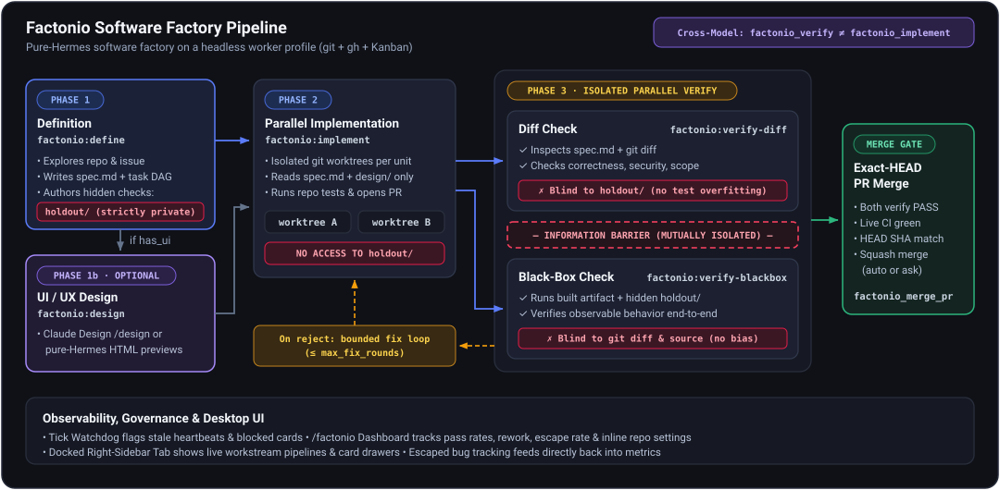

# Factonio Architecture

Factonio is a pure-Hermes software factory plugin that turns any GitHub repository into a structured, multi-phase delivery pipeline using only Hermes Agent, `git`, and `gh`.

## Execution model: Orchestrator + dedicated headless worker

Factonio cleanly separates interactive coordination from autonomous execution:

- **Interactive Orchestrator (your default Hermes profile):** Loads a compact prompt section (`factonio-routing`) and the `factonio:orchestrator` skill. It handles intake, clarifies ambiguity with the user, registers/configures repositories, fans out Kanban cards, monitors verification verdicts, and executes the merge gate.
- **Dedicated Headless Worker (`factonio` profile):** Created by `hermes factonio init` with `approvals.mode: off` and linked directly to the Factonio plugin so workers resolve every `factonio:*` skill. The orchestrator prompt section is automatically suppressed inside worker sessions (`HERMES_KANBAN_TASK` set or active profile equals `factonio`).

Every card spawned by Factonio automatically subscribes the calling chat session (`notify+wake`) so the orchestrator can end its turn immediately after dispatching cards and wake automatically when a card completes or blocks.

## Four-phase workflow and the Information Barrier

### Phase 1 — Definition (`factonio:define`)

- Runs in `goal_mode: true` on the `factonio_define` model slot.
- Explores the repository, diagnoses bugs or designs features, and writes `spec.md` (acceptance criteria, technical approach, parallel task DAG, and `has_ui` flag) inside the workstream's run directory.
- Authors hidden end-to-end acceptance checks under `holdout/`.

### Phase 1b — Optional UI/UX Design (`factonio:design`)

- Spawned when Definition marks `has_ui: true` (or when explicitly requested) and `design_provider != "off"`.
- Supports `auto` (uses interactive Claude Design `/design` PTY when `claude` CLI + credentials are present, else falls back to pure-Hermes HTML/CSS prototyping), `claude-design`, `hermes`, or `off`.
- Writes `DESIGN.md`, static HTML previews, and screenshots into the workstream's `design/` directory without ever seeing `holdout/`.
- Respects `design_approval` (`ask` pauses to present previews to the user; `auto` proceeds directly to Implementation).

### Phase 2 — Parallel Implementation (`factonio:implement`)

- Each independent unit from the spec DAG runs in its own isolated git worktree anchored to a Hermes Project (`<repo-slug>`).
- Workers read `spec.md` and approved `design/` artifacts only — `holdout/` paths are stripped from Implementation card briefs.
- Workers implement changes, run repository tests, push a branch, and open a GitHub PR with its `head_sha`.

### Phase 3 — Isolated Parallel Verification (`factonio:verify-diff` + `factonio:verify-blackbox`)

Every PR launches two concurrent, mutually isolated verification cards on the `factonio_verify` model slot:

| Check | Inputs allowed | Inputs forbidden | Purpose |
|---|---|---|---|
| **Diff Check** (`factonio:verify-diff`) | `spec.md`, `git diff`, PR metadata | `holdout/` | Catch logic errors, security issues, missing edge cases, and scope drift without overfitting to hidden tests |
| **Black-Box Check** (`factonio:verify-blackbox`) | Built artifact, acceptance criteria, `holdout/`, `.factonio/` harness | Source code, `git diff` | Verify observable end-to-end behavior without confirmation bias from reading the implementation |

**Repo verification harness (`harness.py`):** a target repository can carry a git-tracked black-box playbook at `<repo>/.factonio/verify.md` (mandatory `## Launch`, `## Doctor`, `## Drive`, `## Evidence`, `## Cleanup` plus `## Feature Map` and `## Hooks`) and an optional machine-readable `.factonio/harness.json` (`schema_version: 1`: `phases`, `feature_map` of `{id, surface, paths, commands, scenarios}`, `hooks` of `{name, kind: visual_diff|invariant|custom, command, optional}`, `discovered_surfaces` of routes / CLI commands / entrypoints, and the `base_commit` it was generated from). `spawn_verification_pair` discovers it read-only and injects `## Repo Verification Harness` (paths, stage order, declared hooks) into the Black-Box card only; the Diff Check card never sees it, and the result carries additive `harness_present` / `harness_path`. Hand-authored `verify.md`-only harnesses are supported (Doctor commands come from fenced code blocks, hooks from ``- **name** (`kind`, required|optional): `command` `` lines).

- `factonio_bootstrap_verify` / `hermes factonio harness init` detects the stack with stdlib only (`pyproject.toml`, `package.json`, `Cargo.toml`, `go.mod`, `Makefile`, `plugin.yaml`, `.github/workflows/*.yml`, route decorators/handlers, `add_parser` / `[project.scripts]` / `bin`; bounded to 256 KiB per file, depth 8, 4,000 files), writes both files atomically, refuses to overwrite unless `force` (keeping declared hooks), supports `dry_run`, and logs `bootstrap_verify` (phase `harness`) to `trail.db`.
- `check` validates sections, schema, hooks, and dead `feature_map` globs, optionally running Doctor commands (`--run-doctor`) and hooks (`--run-hooks`; only required-hook failures or timeouts fail).
- `audit` is strictly read-only (every git probe uses `--no-optional-locks`, so the index is never refreshed): against `--base`, else `harness.json` `base_commit`, else the last commit touching `.factonio/`, it reports committed and working-tree `changed_files`, `uncovered_changed_files` (source files outside every glob), `stale_features`, `orphaned_globs`, `new_routes` / `removed_routes`, `new_cli_commands` / `removed_cli_commands`, `drifted`, `severity: clean | stale | missing`, and `recommendations`. The `harness-audit` automation blueprint runs it daily across registered repos.

If either check returns `verdict: reject`:

- Within `max_fix_rounds` (default `3`), the orchestrator dispatches a bounded Implementation fix round reporting only observable failure symptoms (never leaking `holdout/` internals), then re-verifies the new `head_sha`.
- Once `max_fix_rounds` is exhausted, the orchestrator escalates the concrete findings to the user.

### Exact-HEAD Merge Gate

Before merging or reporting a PR ready:

1. `factonio_pr_gate` queries GitHub live via `gh api graphql` for PR state, draft status, mergeability (`mergeable`, `mergeStateStatus`), `reviewDecision`, unresolved review threads, head-commit check runs / status contexts, the head `statusCheckRollup.state`, and live `head_sha`. Review threads and check contexts are cursor-paginated (100 per page, up to 20 pages), so PRs with more than 100 checks are gated correctly.
2. Blockers are classified in strict priority tiers and reported in that order, with `blocker_tier` set to the highest-priority active tier (`None` when ready):
   1. merge conflicts (`mergeable == CONFLICTING` or `mergeStateStatus` `DIRTY`/`CONFLICTING`);
   2. unresolved review threads (each returned with `id`, `path`, `line`, `author`, `body` snippet, `created_at`);
   3. failing/pending CI checks, or `mergeStateStatus == BLOCKED` with a head rollup of `ERROR`/`FAILURE`;
   4. merge gates (PR not `OPEN`, draft, or `reviewDecision == CHANGES_REQUESTED`).
3. `factonio_merge_pr` refuses to merge on any blocker or if `head_sha` drifted after Verification passed.
4. On `merge_policy: auto`, the PR is squash-merged and its branch deleted; on `merge_policy: ask`, the orchestrator presents verification results and waits for human approval.
5. After `gh pr merge` exits 0, `factonio_merge_pr` reads the PR back (`state,mergedAt,baseRefName`). Only a confirmed `MERGED` state reports `merged: true`; merge-queue / auto-merge PRs report `merged: false, queued: true`; a PR closed without merging is an error. On a confirmed merge the registered checkout's default branch is fast-forwarded when safe (`local_synced`, `local_sync_note`): a dirty working tree, a diverged branch, or a branch checked out in another worktree is never touched, and a skipped sync never fails the merge.

`repos.py` also provides pure-Python git helpers for verdict continuity: `compute_patch_id` / `verify_patch_continuity` (stable `git patch-id` comparison, so a verified patch survives a mechanical rebase) and `assess_trunk_drift` (files changed on `origin/<default_branch>` vs. the PR since their merge-base).

### Tri-state verification verdicts

Verification cards report `verdict: pass | reject | inconclusive`. `inconclusive` (from run metadata or a run outcome) is never counted as a pass: `/metrics` reports `verification.{diff,blackbox}.inconclusive` and includes it in the `pass_rate` denominator, and `/cards` reports `counts.inconclusive`, which is included in `counts.attention`.

## Per-phase model resolution

Factonio registers five native Hermes Auxiliary Task slots:

- `factonio_define`
- `factonio_design`
- `factonio_implement`
- `factonio_verify`
- `factonio_watchdog`

Resolution precedence (highest to lowest):

1. Per-repository override (`repos.<slug>.models.<subphase>` then `<phase>`)
2. Hermes auxiliary task slot (`auxiliary.factonio_<phase>`) when configured (not `auto`)
3. Fallback to the `factonio` worker profile's default model (then root profile default)

If `implement` and `verify` resolve to the same `(provider, model)`, Factonio surfaces a non-blocking cross-model independence warning in `hermes factonio models`, `hermes factonio doctor`, and the Desktop UI.

## Durable repository storage

Registered repository records live in `<HERMES_HOME>/plugin-data/factonio/repos.json` (read from the root `HERMES_HOME` so worker profiles share the exact same registry as the orchestrator). Legacy entries from `config.yaml` are merged seamlessly and migrated on first update.

Writes acquire an in-process re-entrant thread lock plus an exclusive POSIX `fcntl.flock` on `repos.json.lock`, flush and `fsync` to a unique sibling temp file, and atomically `os.replace()` into place so concurrent CLI, tool, and Dashboard API updates never corrupt the store.

## Watchdog, metrics, and Dashboard API

- **Tick Watchdog (`watchdog.py`):** Hooks `on_kanban_dispatch_tick` (throttled by `watchdog_interval_minutes`, default `5`). Running cards are evaluated in strict order, all deterministic with zero LLM calls: a dead `worker_pid` (POSIX `os.kill(pid, 0)`, skipped when the claim lock names another host) is flagged at once as `dead_worker`; an exceeded `max_runtime_seconds` as `runtime_exceeded`; then side-effect progress (non-heartbeat `task_events`, non-watchdog `task_comments`, worktree commits/index/dirty-file mtimes, and `runs/<tenant>/` file mtimes — metadata only, never file contents) is compared with a phase-aware threshold (`verify-diff` 10m, `verify-blackbox` 15m, `define` 20m, `implement` 25m, `design` 30m; `stale_heartbeat_minutes` above `20` is a floor, below `20` a cap; optional `phase_stale_heartbeat_minutes` per-phase overrides). Fresh side effects mean no alert. Stale side effects with a stale heartbeat raise `stale_running`; with a fresh heartbeat (a looping worker) `no_side_effects`. Only these ambiguous stalls may be triaged by the `factonio_watchdog` model, and only when it is explicitly configured (`auxiliary.factonio_watchdog` or per-repo `models.watchdog`), with a per-task cooldown (`watchdog_triage_cooldown_minutes`, default `15`) and a `<= 15s` timeout: `working` suppresses the alert, `stalled` appends the rationale, `needs_input` becomes `triage_needs_input`; any error, timeout or invalid JSON falls back to the deterministic alert. Blocked cards past `blocked_reminder_minutes` (default `45`), fix-cap cards, and `triage` cards are reported as before. Alerts are deduplicated via plugin state on card revision digest + finding `kind` + current `run_id` (ignoring `factonio:watchdog` comments and volatile age/rationale text), so a repeated condition alerts once while an escalation such as `stale_running` -> `dead_worker`, or a new run, alerts immediately. Workspace progress reads `git status --porcelain=v1 -z --untracked-files=all` with `--no-optional-locks`, so fresh writes inside new untracked directories count and the probe never touches the worker's index.
- **Worktree hygiene (`repos.py`):** `hermes factonio worktrees [repo] [--base <ref>] [--prune-safe] [--json]` audits every linked worktree from `git worktree list --porcelain` (main checkout skipped) with size, age, branch, HEAD, merged-into-base, dirty (`clean` | `wip:N` | `scratch:N`, from `git status --porcelain=v1 -z --ignored=matching --untracked-files=all`: `wip:N` counts tracked edits plus ignored files outside the regenerable cache/build allowlist such as `.env` or local data; `scratch:N` counts untracked files when nothing is protected), remote (`pushed` | `ahead:N` | `no-remote` | `detached`), PR (`#N/state`), and active Kanban card (read-only `kanban.db`), then buckets it by priority `hold-wip` > `hold-active-card` > `hold-open-pr` > `safe` > `review`. The default is strictly read-only (every git probe runs with `--no-optional-locks`, so the audit never refreshes or rewrites a worker's index); `--prune-safe` removes only `safe` worktrees, re-running the same classifier on the live porcelain entry immediately before deletion — registration/branch/HEAD unchanged and not locked/prunable (else `review`), tracked edits and ignored local data (else `hold-wip`), no other registered worktree (including the main checkout) or nested repository inside it (else `review`, since removal is recursive), and a fresh `kanban.db` active-card lookup matching the worktree path or any workspace nested inside it (lexical and symlink-resolved) that fails closed (else `hold-active-card`, reported in `kanban_errors`) whenever the DB is required but missing, not a regular file, or unreadable; the DB is required when `kanban_db_path` is explicit, the default path is unresolvable, or the default DB existed at prune start. A `git worktree remove --force` refusal (e.g. a lock) is never overridden: `rmtree` only clears leftovers of a worktree git already de-registered (admin dir gone) after ownership re-verifies and no registered worktree or nested repository remains inside it. Pruning lists dropped scratch files as `dropped_scratch`, never deletes branches, and the watchdog never prunes automatically.
- **Metrics (`metrics.py`):** Queries `kanban.db` read-only (`?mode=ro`) to compute workstream totals, per-phase median/P90 durations, Diff vs Black-Box pass rates, rework rate (`avg_runs_per_implement_card`), and post-merge escape rate (`escaped_from` cards), plus trail decision counts from `trail.db`.
- **Dashboard API (`dashboard/plugin_api.py`):** Mounted at `/api/plugins/factonio/`:
  - `GET /status` — active/blocked counts, repo count, phase models, cross-model warning
  - `GET /repos` — registered repositories with explicit overrides, effective inherited settings, and global defaults
  - `PATCH /repos/{slug}` — validated partial updates (`merge_policy`, `max_fix_rounds`, `default_branch`, `design_provider`, `design_approval`)
  - `GET /models` — resolved per-phase provider/model matrix
  - `GET /metrics?range=7d|30d|90d|all` — factory KPIs and phase timing percentiles
  - `GET /cards?session_id=...&tenant=...` — enriched Kanban cards for the right-sidebar Factonio tab
  - `GET /trail?tenant=&repo=&phase=&card_id=&limit=100` — append-only decision trail as `{decisions, summary, filters}`; each decision carries parsed `evidence`, `superseded_by`, and `is_superseded`
  - `GET /trail/{decision_id}` — one decision as `{decision}` (same enriched shape) or `404`, used to resolve lineage targets outside a `/trail` window
  - `GET /doctor` — environment and worker profile readiness checks

## Decision trail (`trail.db`)

`trail.py` owns `<root HERMES_HOME>/plugin-data/factonio/trail.db`, Factonio's own SQLite store (`journal_mode=WAL`, `busy_timeout=5000`, `foreign_keys=ON`). `schema_meta` records `schema_version = "1"` so future metrics tables can live here without writing to Hermes's fenced `kanban.db`. Fresh-store initialization (WAL switch + schema) is serialized by an in-process lock plus a POSIX `flock` on the sidecar `trail.db.lock`, and transient `database is locked`/`busy` errors are retried with jittered exponential backoff (corruption errors fail fast), so concurrent first writers never drop decisions.

- **Append-only:** the `decisions` table (`id`, `ts`, `tenant`, `repo_slug`, `phase`, `card_id`, `actor`, `decision`, `why`, `evidence_json`, `result`, `supersedes_id`) has `trg_decisions_no_update` / `trg_decisions_no_delete` triggers that abort any `UPDATE` or `DELETE`. A correction is a new row whose `supersedes_id` must reference an existing row (validated in `log_decision` and by a foreign key).
- **Automatic transitions:** `start_workstream` (plus an `escape` row when `escaped_from` is set), `spawn_design_card`, `spawn_implementation_card`, `spawn_verification_pair`, and the `factonio_pr_gate` / `factonio_merge_pr` tools record rows best-effort; a trail write failure is logged and never blocks card creation or merging.
- **Surfaces:** `factonio_log_decision` (agent tool), `hermes factonio trail` (CLI), `GET /trail` and `GET /trail/{decision_id}` (API), and an additive `trail` block in `GET /metrics` (`decision_count`, `active_count`, `superseded_count`, `by_tenant`, `by_phase`).
- **Desktop:** `desktop/plugin.js` reads `GET /trail?limit=200` through one shared query key and filters client-side: the `/factonio` **Decision Trail** section (repo/workstream/phase filters, evidence pills, lineage jumps; a `/factonio?tenant=` deep link scopes the fetch server-side; a jump to a target outside the loaded window or scope loads it via `GET /trail/{decision_id}`, pins it into the ledger and clears obstructing filters/scope before scrolling, focusing and flashing it) and, in the sidebar tab, per-workstream decision strips plus per-card decisions in the card drawer (polled only while the pane is visible).
- **Escaped regressions:** `escaped_from` adds a required `Verification Gap Analysis` section to the Definition card (why both Diff Check and Black-Box Check missed the bug, plus ladder-ranked prevention proven to fail on the original bug); the retro blueprint mines `trail.db` plus Kanban metrics for mistake classes seen at least twice and applies the `/correct` enforcement ladder.
